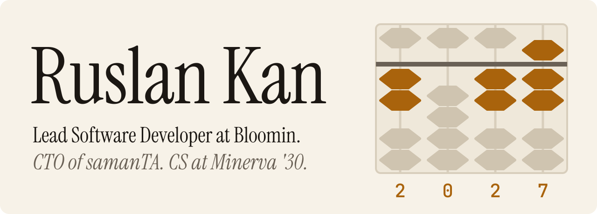
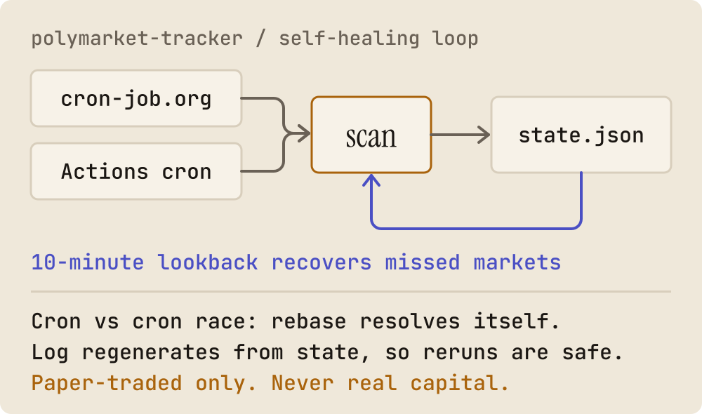

<picture>
  <source media="(prefers-color-scheme: dark)" srcset="assets/hero-dark.svg">
  <source media="(prefers-color-scheme: light)" srcset="assets/hero-light.svg">
  
</picture>

 

I'm a first-year CS student at Minerva University, and I was shipping production AI products before I got here. I'm looking for a **Summer 2027 software engineering internship** in the US, on a team where I can learn large-scale systems: the part of engineering I've only seen at small scale.

The abacus is counting to 2027. I was the Aloha Mental Arithmetic World Grand Champion in 2018, so it felt right.

[Portfolio](https://kan-portfolio-one.vercel.app) · [LinkedIn](https://www.linkedin.com/in/ruslan-kan-207692384/) · [Case studies](https://github.com/PricePepel/kan-case-studies) · [Email](mailto:ruslan.kan@uni.minerva.edu)

## What I'm building

### [Bloomin](https://www.trybloomin.ai) and [samanTA](https://ta.saman.academy)

I'm Lead Software Developer at Bloomin since June 2025, **promoted twice in under a year**, and CTO of samanTA, its AI quiz and tutoring platform for schools. I own samanTA's technology end to end: React web app, FastAPI backend, Telegram bot and Mini App. A PDF goes in, gpt-4o drafts the quiz, and a deterministic schema check runs before anything is saved. Its usage results helped Bloomin win a **€20,000 grant** from EdTech4BY. To bring students back, its notifications escalate through 5 stages and reset the moment someone returns.

### [OLMA](https://github.com/PricePepel/OLMA)

Peer-learning network I founded and shipped in 4 months. School No. 166 still uses it, with **300 active users**, and Bloomin incorporated its coach-to-student code.

### [polymarket-tracker](https://github.com/PricePepel/polymarket-tracker)

A research agent for Polymarket's BTC 5-minute markets that runs itself on GitHub Actions, paper-traded only. When cron drifts, it recovers the markets it missed. When runs collide, the rebase resolves itself. It ran 366+ unattended scans over 3 days.

### [Naviq](https://naviq.vercel.app)

B2B SaaS I founded. Paste a job description and Claude writes a 20-lesson training academy, then employers enrol interns and track their progress. Next.js 16, Supabase, English and Russian. In active build.

## How two of them work

<picture><source media="(prefers-color-scheme: dark)" srcset="assets/samanta-ladder-dark.svg"><source media="(prefers-color-scheme: light)" srcset="assets/samanta-ladder-light.svg"></picture>
<picture><source media="(prefers-color-scheme: dark)" srcset="assets/polymarket-loop-dark.svg"><source media="(prefers-color-scheme: light)" srcset="assets/polymarket-loop-light.svg"></picture>

## Also

- Published a [paper](https://economicjournals.org/index.php/JFBD/article/view/51) on AI in Uzbekistan's banking and insurance systems (JFBD, 2025).
- 30+ olympiads in math and academics.
- Taught Python and web basics to 80+ students at ITSTEP, as a volunteer.
- Minerva moves me through San Francisco, Tokyo, Buenos Aires and Berlin by 2030. I'm in San Francisco now.

## Tools I reach for

**Languages:** TypeScript, Python, JavaScript 
**Product:** React, Next.js, FastAPI, Supabase, Postgres 
**AI:** Anthropic Claude API, OpenAI API, Claude Code, MCP servers 
**Infra:** GitHub Actions, Vercel, Render, Docker, Telegram Bot Platform

The best way to reach me is [ruslan.kan@uni.minerva.edu](mailto:ruslan.kan@uni.minerva.edu).
